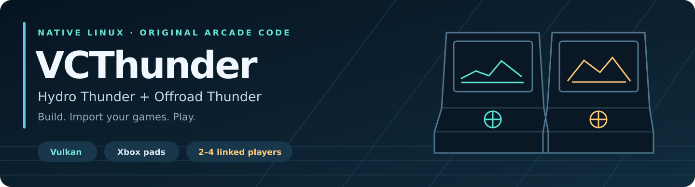
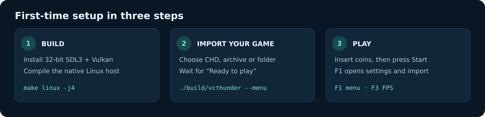
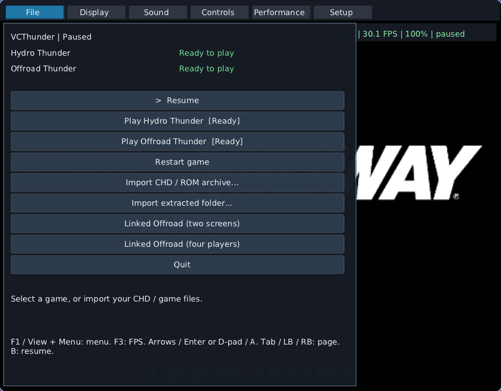

# VCThunder — native Linux



Play **Hydro Thunder** and **Offroad Thunder** on Linux using their original
32-bit x86 game code, a native host, and a Vulkan renderer. Sound, Xbox pads,
rumble, saves and an in-game Nuklear menu are included.

**Offroad supports 2–4 locally linked players:** two views side by side, or a
four-player 2×2 grid. Connected displays share the cabinets automatically.

This is a source port of the host services around the original games. It runs
as a native i386 ELF executable; Wine and Windows libraries are not needed.
**You supply the supported game data.** No ROMs, CHDs or game executables are
included. Based on [mourix/VCThunder](https://github.com/mourix/VCThunder).

[Setup and dependencies](docs/building.md) · [Linked play](docs/linked-play.md) ·
[Architecture](docs/architecture.md)

## Build and launch

Install the [Linux dependencies](docs/building.md#dependencies), including
**32-bit SDL3, zlib and Vulkan drivers**, then:

```sh
git clone https://github.com/CrownParkComputing/VCThunder-Linux.git VCThunder
cd VCThunder
make linux -j4
./build/vcthunder
```

The build downloads a pinned Nuklear header and compiles the shaders to
SPIR-V. Build outputs go to `build/`. Run commands from the repository root.

## First-time setup



1. Launch `./build/vcthunder`. If no game is installed, the setup screen opens.
2. Choose **CHD / ROM archive** for your game disk or complete ZIP/7z/RAR, or
   **extracted game folder** for files you already extracted. A BIOS-only ROM
   ZIP does not contain the game.
3. Wait for **Ready to play**, then select the game. CHD import needs `chdman`,
   `mtools` and `7z`; ZIP and folder imports use Python 3 alone.


The importer checks the game revision and assets, then installs into
`data/hydro/` or `data/offroad/`. It preserves existing installations and saves.
Next launch goes straight into an installed game. To run setup again:

```sh
./build/vcthunder --menu        # setup and import
./build/vcthunder hydro        # launch Hydro Thunder
./build/vcthunder offroad      # launch Offroad Thunder
```

Import is also available from **F1 → File** and the **Setup** tab in-game.
See the [full setup guide](docs/building.md#first-run-import) for supported
files, command-line import and troubleshooting.

## Two- and four-player Offroad

```sh
./build/vcthunder offroad --dual-screen   # two linked players
./build/vcthunder offroad --players 4     # four linked players
```

Or open **F1 → File → Linked Offroad (two screens)** / **(four players)**.
Three players are also supported with `--players 3`.


| Players | One display | Two displays | Four displays |
|---|---|---|---|
| 2 | Side-by-side views | One view per display | Uses the first two |
| 4 | 2×2 grid | Two views per display | One view per display |

Each view is a separate native cabinet, joined through the game's original
local network protocol. Cabinet IDs, linked mode and save directories are
selected automatically. **Pad 1 drives player 1, pad 2 player 2, and so on.**
A missing pad does not reuse another player's controller. Keyboard input goes
to the focused view.

Insert a coin and press Start in each view, then choose the same game mode
and track to race together. Closing any view closes the linked session.


See [linked play](docs/linked-play.md) for the two-player screenshot, launch
options, controller order, display placement and save locations.

## Controls

| Action | Xbox pad | Hydro keyboard | Offroad keyboard |
|---|---|---|---|
| Coin | View | `5` | `5` |
| Start | Menu | `1` | `1` |
| Steer | Left stick | Left / Right | Left / Right |
| Throttle | RT | Up | Left Ctrl |
| Brake | LT | Down | Left Alt |
| Boost / accept | A | Left Ctrl | Space for nitro; Left Ctrl to accept |
| Shift | LB / RB | — | Z / X / C |
| In-game menu | View + Menu | F1 | F1 |
| FPS overlay | — | F3 | F3 |
| Quit | Menu's Quit action | Escape | Escape |

Hydro's default price is three coins. Connect controllers before starting a
linked session; their order follows device enumeration. USB/Bluetooth hotplug
and pad rumble use SDL3. In the Nuklear menu, use mouse, arrows/Enter or
D-pad/A; Tab or LB/RB changes page, and B resumes.

## In-game settings



- **Display:** Vulkan/CPU renderer, resolution scale, texture and HUD filters.
- **Sound:** volume, mute, routing and balance; these apply immediately.
- **Controls:** pad configuration and rumble.
- **Performance:** measured FPS and game-clock speed.
- **Setup:** import another game without leaving the application.

Settings are saved to `vcthunder.ini`. Use **File → Restart game** to apply
renderer, resolution and clock changes. Enabling audio after launching with
it disabled also needs a restart. Linked mode manages its own window layout.

The original simulation runs at **30 Hz**. Raising the clock to 200% can
approach 60 rendered FPS, but **also doubles gameplay speed**. It is not frame
generation. DLSS and frame generation are not implemented. The HUD FSR1 option
is a spatial filter. The overlay names the active backend **Vulkan** or **CPU**.

## Supported game revisions

| Title | Build | Executable SHA-256 |
|---|---|---|
| Hydro Thunder | v01.01b, 1999-02-27 | `a421f5fd4ee0d90f57815975d4a47bb784f2b46d48085e42b422605a029f8e3f` |
| Offroad Thunder | 2000-02-25 | `fa739d0f1a80c6e429ca73fdee04c3d6d6325bb95848cb701114f74bf2a5e9bf` |

Other revisions are rejected before installation because the native hooks
match these exact executables.

## Validation and current limits

```sh
make check-linux       # host, input, network, importer and CPU reference frames
make check-linux-gpu   # Vulkan comparisons; needs a Vulkan desktop session
```

The suite passes **17 native host tests**, including cabinet layout tests,
**eight importer tests**, **eight exact CPU reference frames** and **ten Vulkan
comparison frames**. Two-player linked racing has been verified through peer
masks and synchronized simulation counters. Four-player shared racing was
also verified: every cabinet saw its three peers and advanced in sync.
Details are in the [linked-play guide](docs/linked-play.md#validation).

Multiple physical monitors and four simultaneous physical controllers have
not been hardware-tested. The layout tests cover one to five displays and
2–4 cabinets. Linux x86 with 32-bit libraries is required; ARM is not supported
by this native executable. LAN play between separate PCs remains unverified.

## Licensing and credits

Original VCThunder source and documentation are MIT-licensed: see [LICENSE](LICENSE).
The native menu adapts the DriveClub-Linux bbport Nuklear menu under
**GPL-2.0-or-later**: see [menu/COPYING](menu/COPYING). The combined executable
is distributed under those GPL terms. Nuklear is MIT/public domain; SDL3 and
zlib are system dependencies under their respective licenses.

The SVG diagrams are project-authored. Screenshots show the native port;
game artwork and Hydro Thunder, Offroad Thunder, Midway and 3dfx marks belong
to their owners. Game data is not distributed. This project is unaffiliated
with the original publishers.
