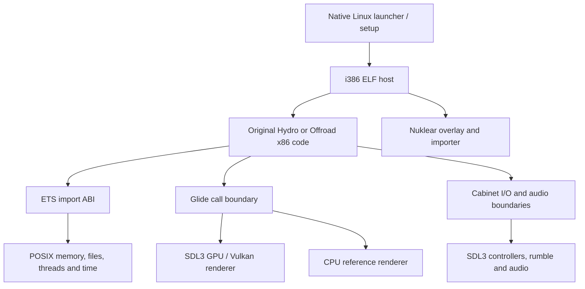

# Native Linux architecture

[Back to the README](../README.md)

The original game executes as x86 code inside a 32-bit Linux host. The port
maps the supported executable at its expected address and replaces the
Phar Lap ETS operating-system and hardware boundaries with native services.
The original executable on disk is kept as game data; patches apply in memory.

## Host and original game ABI

`src/host_main.c` enters the native runtime. The loader maps the game's fixed
address span; `generated/*_profile.c` describes the exact executable revision,
entry points and hook sites. ETS import names and i386 calling conventions
remain those expected by the game. `src/win32_posix.c` implements those names
using Linux services; it does not load a Windows system DLL.

The source of truth for setting defaults/ranges is `src/settings.def`.
`src/ini_doc.c` preserves INI comments and saves changes atomically. Imported
game assets are read-only; cabinet writes are mapped into the save directory.

## Rendering

`renderer/` implements the measured Glide 2.x call interface. Its native
SDL3 GPU backend targets Vulkan; project-authored HLSL is compiled to embedded
SPIR-V with `glslc`. The CPU raster remains the regression reference and
fallback. GPU batches fit within SDL's 4 KiB uniform binding range.

The Nuklear UI is composed as a transparent layer over the game image. Game
code and UI stay in the same process. See the [renderer guide](../renderer/README.md)
for its source layout and comparison checks.

## Input and audio

SDL3 supplies pad discovery, hotplug and rumble. Native host controls are
translated into the original Diego or MagicBus cabinet board protocol. Sound
hooks retain each game's upper audio logic and mix its voices through the
native output backend. Wheels and cabinet hardware need further testing.

## Linked local play

`src/dual_screen.c` supervises 2–4 Offroad processes. Each gets a distinct
cabinet ID, controller slot, save directory and logs. The operator-init hook
sets linked mode before the game initializes its network module.
`src/cabinet_layout.h` distributes views across connected displays;
`src/window_posix.c` applies the resulting fullscreen or tiled geometry.

`src/net_link.c` maps the original cabinet UDP addresses onto loopback without
changing the game's protocol or ports. The socket adapter handles the original
ETS nonblocking request. Receive limits refill during sync barriers so network
progress does not depend on a rendered frame completing.

See [linked play](linked-play.md) for the user-facing commands and limits.

## Verification

Native host, controller, network, importer and layout tests do not need game
data. Synthetic Glide captures verify the CPU reference and Vulkan geometry,
textures and depth. Linked gameplay additionally needs real game assets;
peer masks and synchronized simulation counters establish shared racing.
