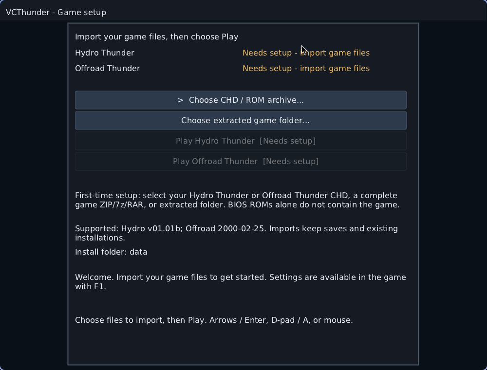

# Native Linux setup

[Back to the README](../README.md)

VCThunder builds a **32-bit x86 Linux executable** and a native shared-library
renderer. Building does not require game data. Playing requires one of the
[supported game revisions](../README.md#supported-game-revisions).

## Dependencies

| Requirement | Purpose |
|---|---|
| GCC with working `-m32`, make, Python 3, pkg-config | Build the native i386 host |
| SDL3 headers and **32-bit SDL3 library** | Windows, controllers and audio |
| zlib headers and **32-bit zlib library** | PNG/bezel and compression support |
| `glslc` | Compile the renderer HLSL to SPIR-V |
| **32-bit Vulkan loader and GPU driver** | Use the GPU renderer |
| `chdman`, `mtools`, `7z` | Import CHD game disks |

SDL2 does not replace SDL3. A working 64-bit Vulkan installation alone does
not provide the 32-bit libraries this executable needs. The compiler, Python
and shader compiler can themselves be 64-bit.

### Arch Linux / CachyOS

With Arch's multilib repository enabled:

```sh
sudo pacman -S --needed base-devel git python pkgconf shaderc \
    sdl3 lib32-sdl3 zlib lib32-zlib lib32-vulkan-icd-loader
```

Install the 32-bit Vulkan driver for your GPU, alongside its matching normal
system driver:

| GPU | 32-bit driver package |
|---|---|
| NVIDIA proprietary | `lib32-nvidia-utils` |
| AMD | `lib32-vulkan-radeon` |
| Intel | `lib32-vulkan-intel` |

For CHDs and PipeWire audio:

```sh
sudo pacman -S --needed mame-tools mtools 7zip lib32-pipewire
```

Package references: [32-bit SDL3](https://archlinux.org/packages/multilib/x86_64/lib32-sdl3/),
[32-bit zlib](https://archlinux.org/packages/multilib/x86_64/lib32-zlib/),
[Vulkan loader and drivers](https://archlinux.org/packages/multilib/x86_64/lib32-vulkan-icd-loader/),
[`glslc` in shaderc](https://archlinux.org/packages/extra/x86_64/shaderc/files/),
and [`chdman` in mame-tools](https://archlinux.org/packages/extra/x86_64/mame-tools/files/).

### Other distributions

Install the same tools and 32-bit development/runtime libraries using your
distribution's multiarch or multilib packages. Package names and SDL3
availability differ. These instructions have been exercised on CachyOS;
there is no verified universal Debian/Fedora install command yet.

Check the selected headers/libraries and compiler before building:

```sh
pkg-config --modversion sdl3
command -v glslc
printf 'int main(void) { return 0; }\n' | gcc -m32 -x c - -o /tmp/vct-i386-check
file /tmp/vct-i386-check
```

The last line should report a 32-bit Intel 80386 ELF executable.

## Build

```sh
git clone https://github.com/CrownParkComputing/VCThunder-Linux.git VCThunder
cd VCThunder
make linux -j4
```

The first build fetches the pinned, SHA-256-checked Nuklear header. Shaders
are compiled at build time, so a runtime shader compiler is not required.
The build produces `build/vcthunder` and `build/libvcglide.so`.

```sh
file build/vcthunder build/libvcglide.so
./build/vcthunder
```

Always launch from the repository root so relative data, settings and save
paths resolve consistently. No Wine, MinGW, Windows SDK or Direct3D is used.

## First-run import



1. Run `./build/vcthunder`. With no installed game, setup opens automatically.
2. Select **Choose CHD / ROM archive...** or **Choose extracted game folder...**.
3. Choose your supported game CHD, complete archive, or extracted game folder.
4. Wait for validation and copying to finish. The title changes from
   **Needs setup** to **Ready to play**; select its Play button.

| Input | Extra tools | What it must contain |
|---|---|---|
| CHD | `chdman`, `mtools`, `7z` | The supported game disk |
| ZIP | Python 3 | Complete extracted game files |
| 7z / RAR | `7z` | Complete extracted game files |
| Folder | Python 3 | Supported executable, game archive and sound assets |

A BIOS-only ROM ZIP is insufficient. Hydro requires `HYDRO.EXE`, `HT.R2` and
all 28 valid binary CSH sound banks. Offroad requires its supported
`offroad3.exe`, `GD3.R2` and accompanying files. Prefer importing the original
CHD when available: the importer merges its partitions and validates assets.

Installations go to `data/hydro/` and `data/offroad/`. Existing installations
and `save/` are preserved. An import targeting a title already installed is
refused rather than overwriting it. Interrupted/cancelled imports remove their
temporary staging files.

To repeat setup, use `./build/vcthunder --menu` or **F1 → Setup** in-game.
The frontend handles imports and launching; the in-game menu holds settings.

### Command-line import

```sh
python3 tools/import-linux.py --root data /path/to/your/game.chd
python3 tools/import-linux.py --root data /path/to/extracted/game
```

The same importer is embedded in the UI. CHD extraction temporarily needs
space for the uncompressed disk and staged game files as well as the final
installation. When extracting manually with mtools, use binary copying:
**`mcopy -a` and `mcopy -t` corrupt binary sound banks.**

## Playing and linked cabinets

```sh
./build/vcthunder hydro
./build/vcthunder offroad
./build/vcthunder offroad --dual-screen
./build/vcthunder offroad --players 4
```

Insert coins with View / `5`, then Start with Menu / `1`. Hydro normally needs
three coins. See the [controls table](../README.md#controls) and
[linked-play guide](linked-play.md).

## Files and updating

| Path | Contents |
|---|---|
| `vcthunder.ini` | Shared and per-title settings |
| `data/hydro/`, `data/offroad/` | Imported game files |
| `save/` | Single-cabinet NVRAM and writable game files |
| `save/offroad-link/cabinet-1/` … `cabinet-4/` | Independent linked cabinets |
| `build/` | Native binaries, objects, generated shaders and test output |

Keep game data and saves when rebuilding or updating. `make clean` removes
build output; it does not remove `data/`, `save/` or an existing `run/` pack.
`make pack` stages native binaries, licenses and an INI into `run/vcthunder/`;
that pack still needs system runtime libraries and your imported game data.

## Troubleshooting

| Symptom | Check |
|---|---|
| `cannot find -lSDL3` / incompatible library | Install **32-bit** SDL3 and ensure pkg-config finds SDL3 |
| `cannot find -lz` or missing 32-bit startup objects | Install 32-bit zlib and your compiler's multilib development support |
| Overlay shows CPU / unexpectedly low FPS | Install the 32-bit Vulkan loader and correct GPU driver; select Auto or GPU in F1 → Display, then restart |
| Import says unsupported revision | Use the exact supported executable build; BIOS files alone do not contain the game |
| Hydro sound banks missing or tiny | Import the original CHD into a fresh data directory; preserve saves |
| Silent audio | Check F1 → Sound, system routing and your 32-bit audio backend; restart if audio was disabled at launch |
| A linked view has no pad | Connect that player's controller before launch; check device order; use the focused view's keyboard meanwhile |
| Wayland placement differs | Linked mode prefers X11/Xwayland when available; a forced native Wayland driver leaves placement to the compositor |

## Verification

```sh
make check-linux
make check-linux-gpu
```

The first command runs the native host/input/network/layout suite, importer
tests and exact CPU reference-frame comparison. The second checks Vulkan
frames against the CPU, including long batches and depth overlap, and needs
a working GPU/video session. Game data is not required for these checks.
