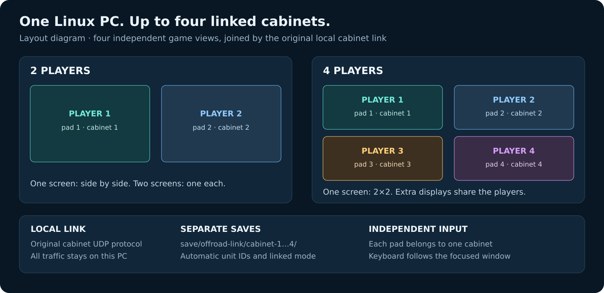
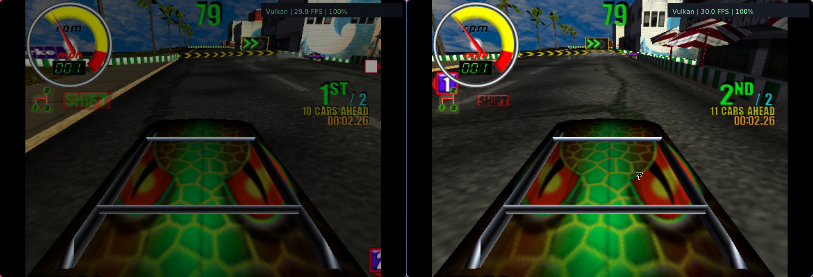
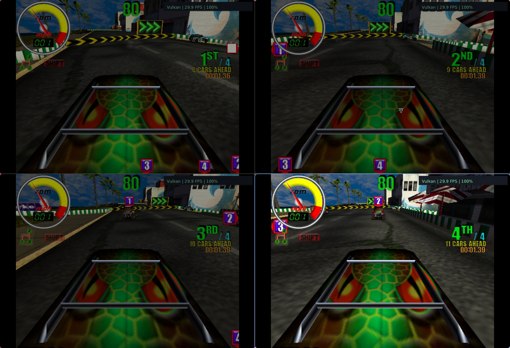

# Offroad linked play: two to four players

[Back to the README](../README.md)

Offroad Thunder's local multiplayer works by linking separate cabinets. This
port runs **one native game process per player** and arranges their windows
on your Linux desktop. They exchange the original cabinet messages over local
UDP. A four-view desktop is a four-cabinet race; there is no shared camera.

## Launch

Install Offroad through the [setup screen](building.md#first-run-import),
connect controllers, and run from the repository root:

```sh
./build/vcthunder offroad --dual-screen   # two players
./build/vcthunder offroad --players 4     # four players
./build/vcthunder offroad --players 3     # three players
```

The **F1 → File** menu has two-player and four-player launch actions. Linked
launch is currently implemented for Offroad; Hydro remains single-cabinet.

## Display layouts



| Cabinets | One display | Two displays | Three displays | Four or more |
|---|---|---|---|---|
| 2 | Side by side | One per display | Uses first two | Uses first two |
| 3 | 2×2 with one unused cell | Two on first, one on second | One each | Uses first three |
| 4 | 2×2 grid | Two per display | Two on first, one on each remaining | One each |

On one display, four-player order is **1 top left, 2 top right, 3 bottom left,
4 bottom right**. With two displays, players 1/2 share the first and 3/4 the
second. A display occupied by one cabinet is fullscreen; shared displays use
borderless tiles. Window contents keep the configured game aspect ratio.

Automatic placement uses the display order reported by SDL. Linked launch
prefers X11/Xwayland when `DISPLAY` is available. If you explicitly select a
native Wayland driver, the compositor can override requested positions.
Display topology is selected at launch; restart after changing monitors.

### Two players



### Four players



These are actual native-port captures. The layout illustration above is a
project-authored diagram.

## Starting a shared race

1. Insert a coin in **each** cabinet: View on its pad, or `5` with that view
   focused. Press Menu / `1` to start each player.
2. Choose the same game mode and track during the selection period.
3. Confirm vehicle/transmission choices with the normal accept control.
4. The cabinets synchronize and launch the shared race.

Cabinet IDs and linked mode are configured automatically at startup. There
is no need to edit the game's operator menu or copy another cabinet's NVRAM.
Keep all players at the same game-clock speed, normally 100%.

## Controllers and keyboard

| View | Controller | Independent save folder |
|---|---|---|
| Player 1 | Pad 1 | `save/offroad-link/cabinet-1/` |
| Player 2 | Pad 2 | `save/offroad-link/cabinet-2/` |
| Player 3 | Pad 3 | `save/offroad-link/cabinet-3/` |
| Player 4 | Pad 4 | `save/offroad-link/cabinet-4/` |

Each controller continues driving its view in the background. A missing pad
leaves that view without pad input; it cannot fall back to another player's
pad. Controllers are assigned in device enumeration order, so connect all
pads before launching and check the order if the wrong view responds.

Keyboard controls affect the focused view. Click a view first; `5` adds a
coin, `1` starts, arrows steer, Left Ctrl accelerates/accepts, Left Alt brakes,
Space activates nitro, and Z/X/C select gears. A keyboard can drive one
focused view while other players use pads. It does not provide four separate
keyboard maps.

The menu pauses its own game process. Make graphics/setup changes before a
linked race; the other cabinets depend on that process to keep synchronizing.

## Saves, logs and quitting

Each cabinet has its own NVRAM, writable files, `game.log` and `glide.log`.
They share the installed game data read-only. Single-player saves stay in
their original directory.

```sh
./build/vcthunder offroad --players 4 --save /path/to/saves
```

This creates `/path/to/saves/offroad-link/cabinet-1/` through `cabinet-4/`.
To inspect the launch plan without starting games:

```sh
./build/vcthunder offroad --players 4 --dry-run
```

Quit or close any cabinet to close the full linked session. The supervisor
signals the remaining processes so their normal shutdown can flush saves.
Run one linked session per PC: the original cabinet addresses and ports are
fixed, so another simultaneous session would contend for them.

## Validation

Two-player shared racing was observed with peer masks `2` and `1` and
matching simulation counters advancing from frame 32 to 62. This verifies
shared simulation rather than only discovery packets. The layout test suite
checks unique, balanced placement for 2–4 cabinets across one to five displays.
Four-player shared racing was also observed: the peer masks were `14`, `13`,
`11` and `7`, meaning each cabinet saw all three other players. In the final
capture, all four advanced 30 simulation frames over the same one-second
interval and stayed within one frame of each other. The four views show about
29.9 FPS at the original 100% clock on the test machine; this is an observed
session, not a hardware-independent performance guarantee.

The game uses four cabinet unit IDs. In a four-player race, each view should
report the other three as its peers and advance its simulation in step with
them. Tests use isolated saves and synthetic input; they do not establish that
four physical pads or four physical monitors have been hardware-tested.

The local transport maps cabinet identities to `127.0.0.10` through
`127.0.0.13`; UDP ports remain 5280 and 8009. Traffic stays on loopback. This
launcher is for one Linux PC. Separate-PC LAN and original hardware cabinet
linking have not been verified.
